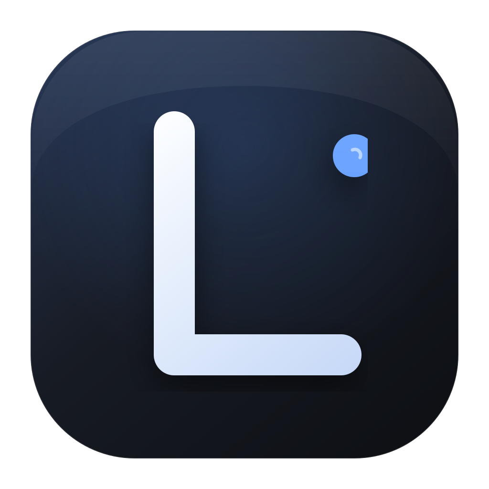
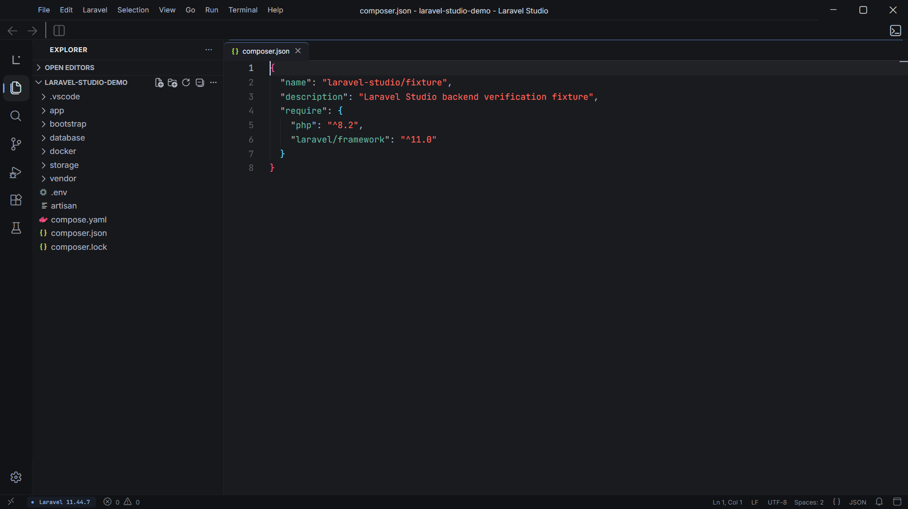

# Laravel Studio

**A free, local-first desktop IDE for Laravel.**

[](https://github.com/DevMostafaHegazy/Laravel-Studio/actions/workflows/ci.yml)
[](https://github.com/DevMostafaHegazy/Laravel-Studio/actions/workflows/release.yml)
[](LICENSE)
[](#build-installers)

Laravel Studio puts the everyday Laravel workflow in one calm workbench: a real
editor, terminal, Git, PHP debugging, a project-aware dashboard, and a focused
file explorer. It is built on Eclipse Theia, so the extension host is real and
open, but the product surface is shaped around Laravel rather than a generic
editor.





## Contents

- [Features](#features)
- [Install](#install)
- [Run from source](#run-from-source)
- [Build installers](#build-installers)
- [Architecture](#architecture)
- [Documentation](#documentation)
- [Privacy and licensing](#privacy-and-licensing)
- [Contributing](#contributing)

## Features

### Workbench

- Direct-to-workbench startup with the file explorer ready for a project.
- Seti file and folder icons, folder selection when a workspace opens, and
  automatic reveal of the active editor file.
- Monaco editor with syntax highlighting, multi-cursor editing, find and replace,
  bracket matching, indentation guides and smooth caret motion.
- Tabs, split editors, terminal, source control, search and a quiet status bar.
- JetBrains-inspired dark workbench with visible focus, reduced-motion support
  and a compact, resizable project panel.

### Laravel project dashboard

- Runtime, project-health and environment readiness checks.
- Route browser with controller navigation.
- Artisan command browser with captured output.
- Test runner for Pest, PHPUnit or Artisan tests.
- SQLite, MySQL/MariaDB and PostgreSQL browser with a bounded query runner.
- Docker Compose and Laravel Sail controls.

### Developer tooling

- VS Code extension support through **Open VSX** and local `.vsix` installation.
- Bundled PHP IntelliSense, Xdebug, Laravel Blade, Laravel snippets, Tailwind
  CSS, EditorConfig and dotenv support.
- Laravel project creation through Composer.
- One-click Xdebug launch configuration.
- Remote SSH development through Theia.

### Open-source project practices

- MIT-licensed source with no paid activation or account requirement.
- Local-first defaults and telemetry disabled.
- Architecture decision records, contribution guide, security policy and issue
  templates.
- CI for tests and a native-runner release workflow for all supported platforms.

See [FEATURES.md](FEATURES.md) for the complete feature reference.

## Install

Download the latest installer from
[GitHub Releases](https://github.com/DevMostafaHegazy/Laravel-Studio/releases).

| Platform | Packages |
| --- | --- |
| Windows 10/11 x64 | NSIS installer, portable `.exe` |
| Linux x64 | `.AppImage`, `.deb` |
| macOS Intel | `.dmg`, `.zip` |
| macOS Apple Silicon | `.dmg`, `.zip` |

The public builds are currently unsigned. Windows SmartScreen and macOS
Gatekeeper may ask for confirmation on first launch. See
[the installation guide](docs/INSTALL.md) for prerequisites and signing notes.

## Run from source

Requirements:

- Node.js **24.x** (the repository includes `.nvmrc`)
- npm 10+
- PHP **8.2+** and Composer 2
- Git
- Optional: Docker Desktop / Docker Engine for containers
- Optional: Xdebug 3 for step debugging

```bash
nvm use
npm ci
npm run plugins   # downloads Open VSX and built-in extensions at build time
npm start
```

`npm start` compiles the first-party extension and launches the built Electron app directly. If no build output exists yet, it runs a one-time production build automatically. Subsequent launches skip the development launcher and start much faster.

## Build installers

Build on the target operating system, or use the release workflow:

```bash
npm run package:win     # NSIS installer + portable build
npm run package:linux   # AppImage + deb
npm run package:mac     # dmg + zip
```

Artifacts are written to `electron-app/dist/`. Native modules mean Windows,
Linux and macOS packages should be produced on their native operating systems.
The release workflow handles that matrix on GitHub-hosted runners.

## Architecture

```text
electron-app/                  Theia Electron shell, branding and packaging
extensions/laravel-tools/
  src/common/                  JSON-RPC contract shared by both processes
  src/node/                    Privileged backend services
    services/                  Database, Docker and scaffolding collaborators
  src/browser/                 React views, commands and the workbench UI
plugins/                       First-party theme and snippets extensions
scripts/                       Build, asset, plugin and verification tooling
docs/                          Architecture, development and release guides
```

The browser talks to the backend through a narrow `LaravelProjectService`
contract. Filesystem access, processes, database connections and Docker commands
stay in the Node backend. See [Architecture](docs/ARCHITECTURE.md) for the
dependency rule, data flows, security boundaries and SOLID mapping.

## Documentation

| Guide | What it covers |
| --- | --- |
| [Architecture](docs/ARCHITECTURE.md) | System design, layers, SOLID principles, security boundaries |
| [Development](docs/DEVELOPMENT.md) | Setup, quality gates, extension points and coding conventions |
| [Release process](docs/RELEASE.md) | Versioning, native builds, signing and GitHub releases |
| [Installation](docs/INSTALL.md) | Platform requirements and troubleshooting |
| [Features](FEATURES.md) | Complete feature reference |
| [Roadmap](ROADMAP.md) | Current direction and non-goals |
| [Changelog](CHANGELOG.md) | Released and unreleased changes |
| [Architecture decisions](docs/decisions/) | ADRs for major technical choices |

## Privacy and licensing

- Laravel Studio is **MIT-licensed** and has no paid license, account or
  activation check.
- Telemetry is disabled by default (`telemetry.telemetryLevel: off`). The IDE
  does not automatically upload workspace files or project contents.
- Local project inspection runs on your computer. Network activity only occurs
  for actions that need it, such as installing an extension from Open VSX,
  creating a project with Composer, connecting to a remote host over SSH, or
  using tools that communicate with services configured in your project.
- Third-party extensions are separate software and may have their own network
  behavior and license terms. Review an extension before installing it.
- The bundled PHP Intelephense extension works without a paid key for its free
  feature set. Its vendor offers separately licensed premium features; Laravel
  Studio includes no key and does not require those features.
- GitHub Actions uploads application build artifacts to GitHub releases. It
  does not upload projects you open in the IDE.

See [Third-party notices](THIRD_PARTY_NOTICES.md) for component licenses.

## Contributing

Contributions are welcome. Start with [CONTRIBUTING.md](CONTRIBUTING.md) and the
[development guide](docs/DEVELOPMENT.md). Please report security issues privately
through [SECURITY.md](SECURITY.md), and follow the
[Code of Conduct](CODE_OF_CONDUCT.md).

## License

MIT © Laravel Studio contributors. See [LICENSE](LICENSE).
