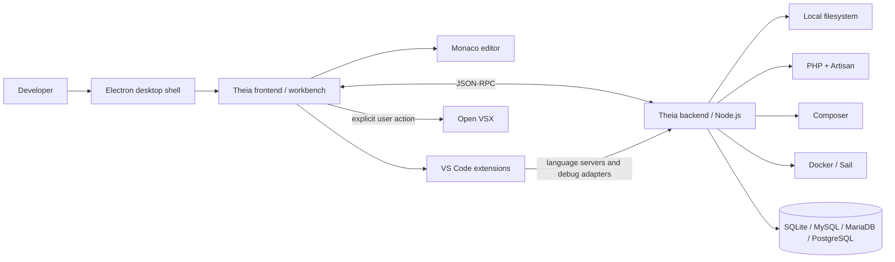
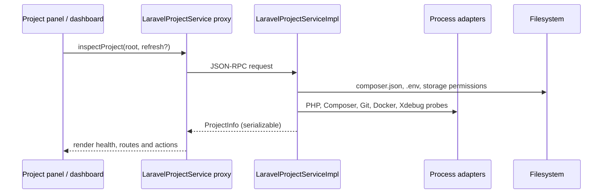
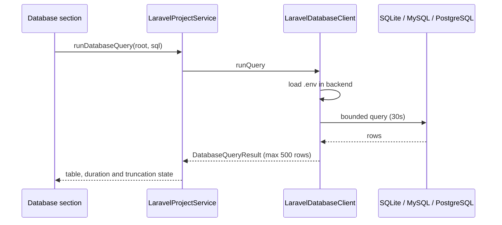

# Architecture

Laravel Studio is a desktop Laravel IDE built as an Eclipse Theia application.
This document describes the system boundaries, the dependency rule, and the
design principles used when adding features.

## System context



The renderer is intentionally not given direct filesystem or process access.
Project inspection, command execution, database access and file mutations run in
the Node backend and return serializable protocol objects over RPC.

## Repository layout

```text
electron-app/                 Theia Electron product shell and packaging
extensions/laravel-tools/
  src/common/                 Shared RPC contract (the transport boundary)
  src/node/                   Backend services and process adapters
    services/                 Focused domain collaborators
  src/browser/                React views, commands and UI services
    dashboard/                Laravel dashboard sections
    sidebar/                  Project panel
    style/                    Tokens, workbench polish and view styles
plugins/
  laravel-studio-theme/       First-party file/UI theme
  laravel-studio-snippets/    First-party Laravel and Blade snippets
scripts/                      Build, asset, plugin and verification tooling
docs/                         Product and engineering documentation
```

## Dependency rule

Dependencies point inward:

1. **Common** contains contracts and plain data. It has no Node, browser or
   Theia runtime dependency.
2. **Node backend** implements those contracts and owns all privileged access.
3. **Browser frontend** consumes contracts through inversion of control and
   never imports backend implementation modules.
4. **Electron/Theia** is infrastructure. It supplies the window, editor,
   terminal, extension host, RPC transport and packaging.

Changes to a protocol model should start in `src/common/laravel-protocol.ts`.
Changes to privileged behavior belong in `src/node`. Changes to presentation
belong in `src/browser`.

## SOLID mapping

| Principle | Application in this codebase |
| --- | --- |
| **Single Responsibility** | `LaravelDatabaseClient` owns database connections and queries; `LaravelDockerClient` owns Compose operations; `LaravelProjectScaffolder` owns project creation and debug configuration; dashboard sections render one concern each. |
| **Open/Closed** | New Laravel capabilities are added by extending the protocol and composing a backend service. Existing dashboard sections and commands do not need to change when an unrelated capability is added. |
| **Liskov Substitution** | `LaravelProjectServiceImpl` is the complete implementation of the `LaravelProjectService` contract exposed to the renderer. Browser code depends on that contract, not on a concrete transport or process implementation. |
| **Interface Segregation** | The RPC contract exposes only the operations the workbench needs. Backend helpers such as process spawning and SQLite normalization are not exposed to the UI. |
| **Dependency Inversion** | The renderer injects the `LaravelProjectService` symbol; the backend binds the implementation in `laravel-studio-backend-module.ts`. Higher-level code does not construct database, Docker or Composer infrastructure directly. |

## Request flow: inspect a project



Project inspection is cached for 10 seconds and route/Artisan metadata for
20 seconds. A refresh bypasses the cache. The renderer never receives `.env`
values that are not explicitly part of `LaravelEnvironment`; password and secret
fields are not in the contract.

## Request flow: run a database query



## Security boundaries

- **Process execution:** arguments are passed as arrays to `cross-spawn`; no
  shell interpolation is used.
- **Project scope:** every privileged operation calls `assertProjectRoot` and
  resolves paths inside the selected workspace.
- **Secrets:** `.env` values are parsed in the backend. Credentials are not
  included in `ProjectInfo`, dashboard props or logs.
- **Commands:** only an allow-list of Composer commands can be run from the UI.
- **Database output:** rows are bounded; binary values are replaced with a
  descriptive placeholder.
- **Telemetry:** disabled by default. See the privacy notes in the README.
- **Extensions:** installed third-party extensions run with their own permissions
  and network behavior. Review them before installation.

## Extension points

- **New dashboard section:** add a section type in `ui-constants.ts`, a component
  under `dashboard/`, render it from `laravel-dashboard-widget.tsx`, and add a
  corresponding backend contract when required.
- **New backend capability:** add the serializable operation to the common
  protocol, implement it in a focused backend service, bind the service in the
  module, and expose it through the facade.
- **New command:** register it in `laravel-command-contribution.ts`; keep the
  command id in `ui-constants.ts` so menus, tests and keybindings share one
  source of truth.
- **New theme asset:** add it to `plugins/` and keep the extension self-contained.

## Architectural decisions

- [ADR 0001: Build on Eclipse Theia](decisions/0001-theia-platform.md)
- [ADR 0002: Keep privileged work in the backend](decisions/0002-backend-boundary.md)

## Trade-offs and follow-up work

The backend facade still contains project inspection and Artisan/route command
coordination. They are kept together because they share process adapters and
short-lived caches, but they can be extracted into a project-inspector and
command-service pair without changing the RPC contract. This is deliberately
recorded as follow-up work rather than hidden behind a speculative abstraction.
